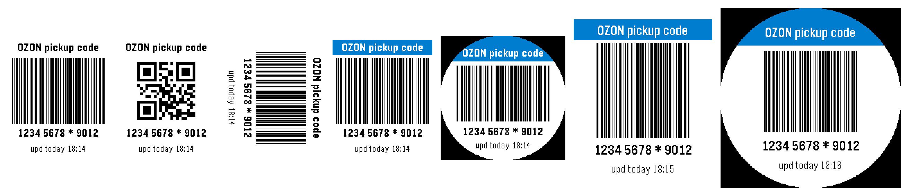
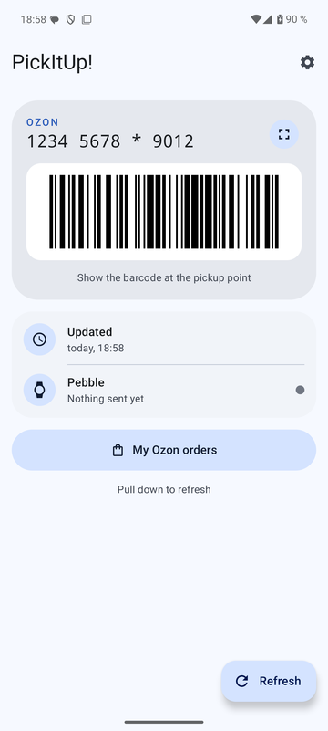
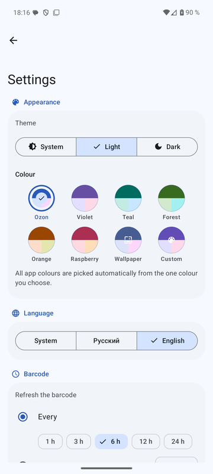

# PickItUp!

Ozon order-pickup barcode on your Pebble. Show the watch at the pickup point instead of
reaching for the phone.

Штрихкод для получения заказов Ozon на часах Pebble: в пункте выдачи достаточно показать часы.

  
  

## How it works

- **Android companion** — you log in to Ozon once inside the app; it fetches your pickup
  barcode and sends it to the watch. It wakes up on its own when the watch asks for the code,
  and can refresh it in the background (every N hours or daily at a set time).
- **Watchapp** — draws the Code 128 barcode itself and keeps it on the watch, so it works
  without a phone connection. One build for every Pebble: Pebble, Pebble Steel, Pebble Time,
  Time Steel, Time Round, Pebble 2, Pebble 2 Duo, Pebble Time 2, Pebble Round 2.

Watch buttons: SELECT — barcode / QR / rotated barcode, hold SELECT — link to the phone app
(BACK closes it), UP — refresh. The footer shows when the code was updated ("upd today 14:05",
or "outdated").

The companion is a Material 3 app (light / dark / Material You colours, Russian and English):
it shows the same barcode on the phone, which watch is connected and whether it got the code,
and has a demo mode for screenshots.

## Install

Requires Android 12+ and the Pebble app (Core Devices).

1. Download `pickitup.apk` from [Releases](https://github.com/RealGrapie/PickItUp/releases/latest),
   install it and log in to Ozon.
2. Install `pickitup.pbw` from the same release on the watch via the Pebble app.

## Build

- Watch: Pebble SDK 4.33 — `cd watch && pebble build` → `build/watch.pbw`
- Android: `cd android && ./gradlew assembleRelease` (JDK 17+, Android SDK 37) →
  `app/build/outputs/apk/release/app-release.apk`. Unit tests: `./gradlew testDebugUnitTest`.

Release builds are signed with the key from `android/keystore.properties` (not in the repo:
`storeFile`, `storePassword`, `keyAlias`, `keyPassword`); without that file they get the debug
key, which is fine for your own builds. GitHub Actions builds the APK and runs the tests on every
push.

## Privacy

Your Ozon login stays in the app's WebView on your phone. PickItUp! itself has no analytics,
trackers or servers: it only opens the Ozon website (which loads Ozon's own scripts, as in a
browser) and sends the code to the Pebble app on the same phone.
Anyone who has your barcode can collect your orders, so don't post screenshots of it.

## Disclaimer

PickItUp! is an unofficial app and is not affiliated with, endorsed by or connected to Ozon.
"Ozon" is a trademark of its respective owner. The app uses the Ozon website the same way a
browser does, on behalf of the logged-in user; your session stays on your phone.

## License

[MIT](LICENSE) © 2026 Grapie. Material icons: Apache License 2.0 (Google).
