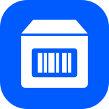
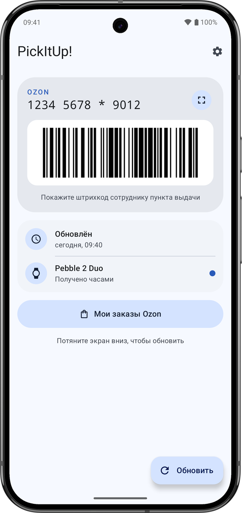
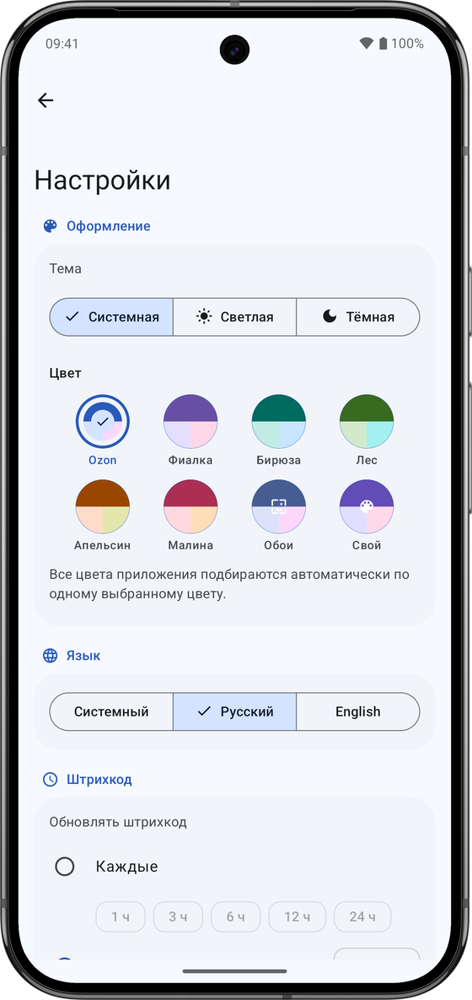

<a href="README.md">English</a> | <b>Русский</b>

  

<h1 align="center">PickItUp!</h1>

  Штрихкод для получения заказов Ozon на часах Pebble: в пункте выдачи достаточно показать часы,
  телефон доставать не нужно.

  

  
  &nbsp;&nbsp;
  

> [!NOTE]
> **Статус проекта:** PickItUp! поддерживается с помощью ИИ (код написан в основном Claude Code) и
> находится на ранней стадии: он начинался как личный проект. Возможны активные изменения и
> ошибки. Подробнее — в разделе [Участие в разработке](#участие-в-разработке).

## Как это работает

- **Приложение для Android** — вы один раз входите в Ozon прямо в приложении, а оно получает
  ваш штрихкод и отправляет его на часы. Приложение запускается само, когда часы запрашивают код,
  и может обновлять его в фоне (раз в N часов или каждый день в заданное время).
- **Watchapp** — сам рисует штрихкод Code 128 и хранит его на часах, поэтому показывает код и без
  связи с телефоном. Одна сборка для всех Pebble: Pebble, Pebble Steel, Pebble Time,
  Time Steel, Time Round, Pebble 2, Pebble 2 Duo, Pebble Time 2, Pebble Round 2.

Кнопки часов: SELECT — штрихкод / QR / повёрнутый штрихкод, долгое нажатие SELECT — ссылка на
приложение для телефона (закрывается кнопкой BACK), UP — обновить код. Внизу экрана видно, когда
код обновлялся ("upd today 14:05"
или "outdated").

Приложение для телефона сделано в стиле Material 3: светлая и тёмная тема, цвета Material You,
русский и английский язык. Оно показывает тот же штрихкод на телефоне, какие часы подключены и
получили ли они код, а для скриншотов есть демо-режим. Новые версии приложение само ищет в GitHub
Releases и ставит обновление в два нажатия (Android один раз попросит разрешить установку
из PickItUp!).

## Установка

Нужны Android 12+ и приложение Pebble (Core Devices).

1. Скачайте `pickitup.apk` (кнопка GitHub ниже или [Releases](https://github.com/RealGrapie/PickItUp/releases/latest)),
   установите и войдите в Ozon.
2. Установите watchapp из Pebble App Store или Rebble либо поставьте `pickitup.pbw` из того же
   релиза через приложение Pebble.

  
  &nbsp;
  
  &nbsp;
  

## Сборка

- Часы: Pebble SDK 4.33 — `cd watch && pebble build` → `build/watch.pbw`
- Android: `cd android && ./gradlew assembleRelease` (JDK 17+, Android SDK 37) →
  `app/build/outputs/apk/release/app-release.apk`. Юнит-тесты: `./gradlew testDebugUnitTest`.

Релизные сборки подписываются ключом из `android/keystore.properties` (его нет в репозитории:
`storeFile`, `storePassword`, `keyAlias`, `keyPassword`); без этого файла используется
отладочный ключ, для своих сборок этого достаточно. GitHub Actions собирает APK и запускает тесты
при каждом пуше.

## Приватность

Данные входа в Ozon хранятся в WebView приложения на вашем телефоне. У самого PickItUp! нет
аналитики, трекеров и серверов: приложение только открывает сайт Ozon (который загружает свои скрипты, как в
браузере) и передаёт код приложению Pebble на том же телефоне.
Любой, у кого есть ваш штрихкод, может забрать ваши заказы, поэтому не публикуйте его скриншоты.

## Отказ от ответственности

PickItUp! — неофициальное приложение, оно не связано с Ozon и не одобрено им. «Ozon» — товарный
знак своего владельца. Приложение пользуется сайтом Ozon так же, как браузер, от имени вошедшего
пользователя; данные входа остаются на вашем телефоне.

## Участие в разработке

PickItUp! написан в основном с помощью ИИ (Claude Code) и развивается в связке с ИИ-ассистентом.

- Сообщения об ошибках и идеи в Issues приветствуются.
- Pull request'ы тоже, но это личный проект без формальных правил участия, и изменения могут
  не принять, если они расходятся с тем, что нужно автору.
- Код и архитектура рассчитаны на работу с ИИ: в [CLAUDE.md](CLAUDE.md) описаны контекст проекта,
  соглашения и правила, выученные на ошибках. Начинайте с него, с ИИ-ассистентом или без.

## Лицензия

[MIT](LICENSE) © 2026 Grapie. Иконки Material: Apache License 2.0 (Google).
В кнопках магазинов использованы шрифты Google Sans Flex и Roboto (SIL OFL 1.1); логотипы
GitHub, Pebble App Store и Rebble принадлежат их владельцам.
